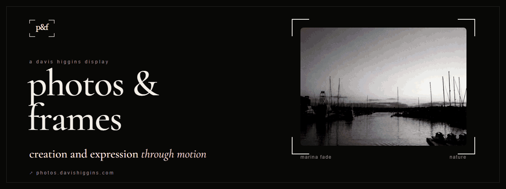
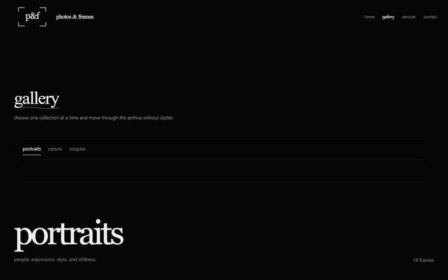
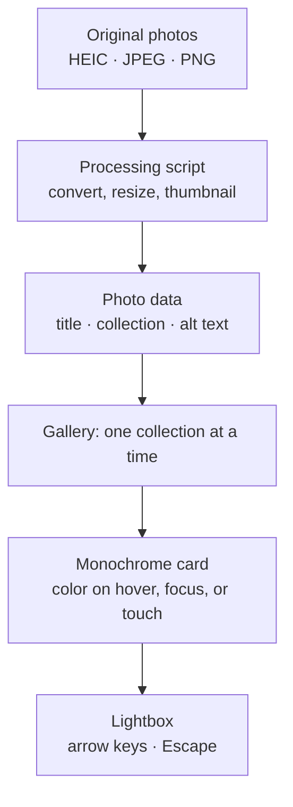
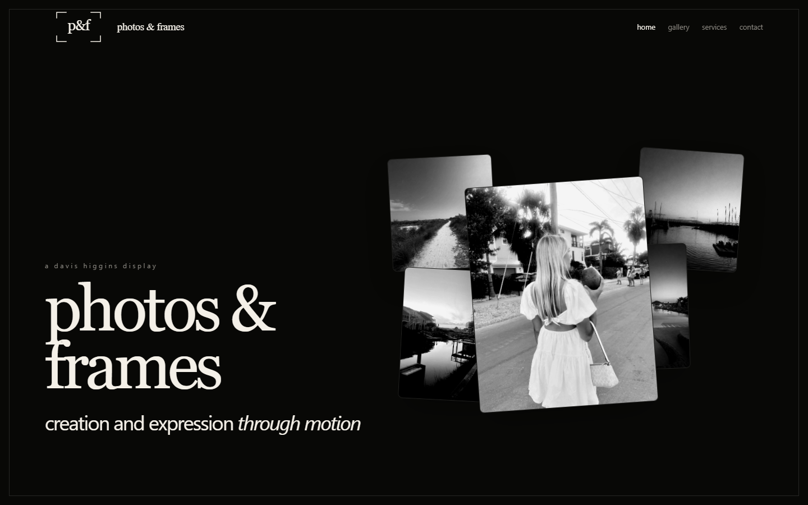
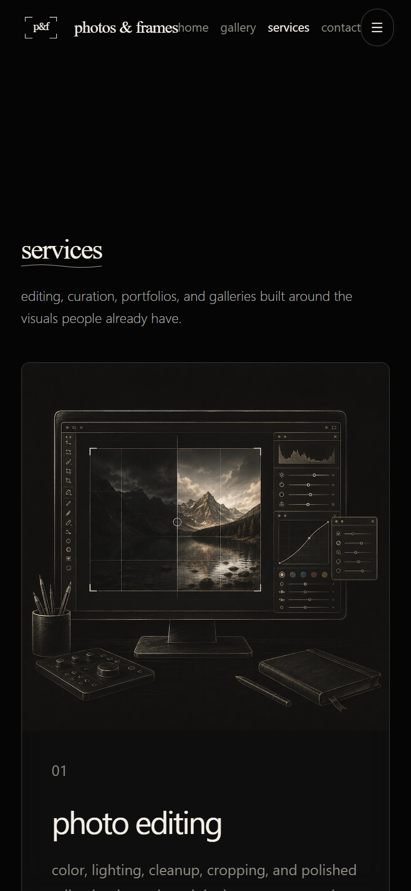
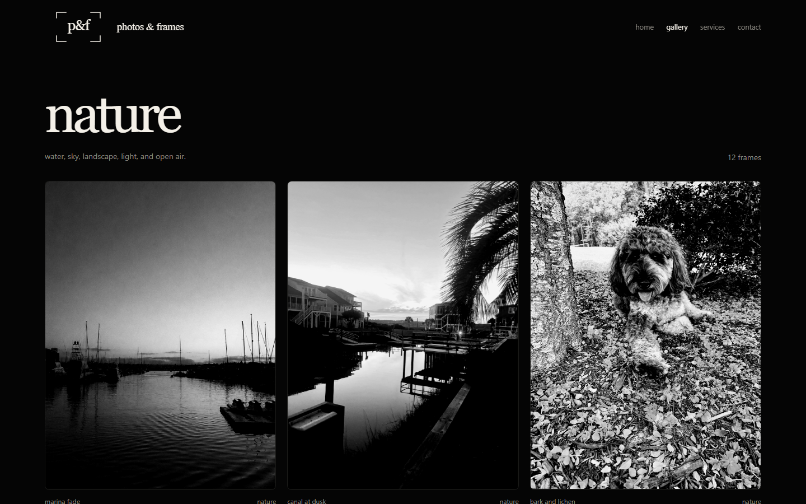

  

<h1 align="center">photos &amp; frames</h1>

  <strong>My photography portfolio: galleries shown in black and white until you reach for them, plus editing, curation, and gallery services.</strong> 
  <a href="https://photos.davishiggins.com"><strong>View the gallery ↗</strong></a> · <a href="https://www.higginsd.com/work/photos-and-frames">Case study</a> · <a href="https://davishiggins.com">Davis Higgins</a>

Live · Photography, design, and build by Davis Higgins

---

## See it in motion

  

Real capture of the live gallery's nature collection. <a href="assets/demo.png">Static frame</a>

## What it does

- **Color is earned.** Every photo shows in black and white by default and reveals its real color on hover, focus, or touch, so the eye reads composition first and color second.
- **One collection at a time.** The gallery is split into portraits, nature, and couples. Each collection shows its frame count and opens into a full-screen lightbox with keyboard navigation.
- **More than a portfolio.** A services page covers photo editing, portfolio websites, custom galleries, and visual curation, with a contact route for inquiries.

## Why I built it

I wanted a home for my photography that felt like an exhibition, not a feed. The site uses a single visual rule: monochrome first, color on intent. Lowercase type and quiet chrome stay out of the pictures' way.

## What I built

I took the photographs and designed and built the site:

- The black-and-white-to-color interaction, working with a mouse, the keyboard, and touch
- Collection-based gallery browsing with a lightbox
- An animated homepage composition, smooth scrolling, and page motion
- A photo processing script that converts HEIC, JPEG, and PNG originals into resized web images and thumbnails
- The services and contact pages

## How it's put together

### Engineering decisions

| Decision | Why |
|---|---|
| **The reveal works without a mouse** | Color isn't hover-only. Cards respond to keyboard focus and to a tap on touch screens, so the core interaction works for everyone. |
| **Only the lead image loads eagerly** | Gallery images lazy-load and decode asynchronously, and only priority images load up front. An image-heavy page stays responsive on a phone. |
| **One data file describes every photo** | Titles, collections, and alt text live together, and a photo can belong to more than one collection without being duplicated. |

## Screens

<table>
  <tr>
    <td width="62%"></td>
    <td rowspan="2" width="38%" align="center"></td>
  </tr>
  <tr>
    <td></td>
  </tr>
</table>

Homepage · Nature collection · Services on mobile

## Technology

| Layer | Technology | Responsibility |
|---|---|---|
| App | React, TypeScript, Vite | Single-page site with client routing |
| Styling | Tailwind CSS | Monochrome editorial layout |
| Motion | GSAP, Framer Motion, Lenis | Homepage composition, reveals, smooth scroll |
| Images | sharp, heic-convert (build script) | Converting and resizing originals |
| Hosting | Vercel | Static deployment |

## Notes

- **The photographs are mine.** This showcase uses only landscapes and the site's own homepage composition. It doesn't republish the portrait or couples collections.
- **Measured claims only.** No performance scores are quoted here, because none have been measured and dated for publication.

## About this repository

This is a documentation-only showcase. The site's source and original photo files aren't included here.

**[View the gallery ↗](https://photos.davishiggins.com)** · Photographed and built by [Davis Higgins](https://davishiggins.com) · [More of my work](https://github.com/DavisHiggins)

© 2026 Davis Higgins. Photographs and screenshots in this repository are shared for portfolio viewing only and may not be reused.
