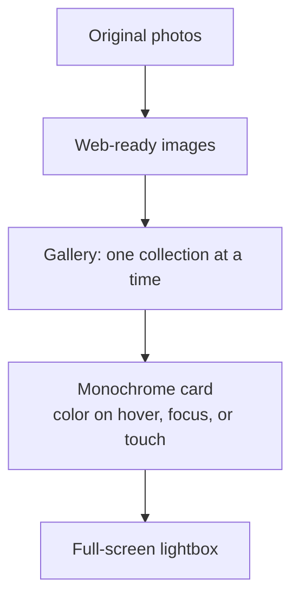

  

<h1 align="center">photos &amp; frames</h1>

<strong>My photography portfolio: galleries shown in black and white until you reach for them, plus editing, curation, and gallery services.</strong>

  &nbsp;
  &nbsp;
  

Live · Photography, design, and build by Davis Higgins

---

## See it in motion

  

Real capture of the live gallery's nature collection. <a href="assets/demo.png">Static frame</a>

## What it does

- **Color is earned.** Every photo appears in black and white and reveals its real color on hover, focus, or touch, so the eye reads composition first and color second.
- **One collection at a time.** The gallery is split into portraits, nature, and couples. Each collection shows its frame count and opens into a full-screen lightbox with keyboard navigation.
- **More than a portfolio.** A services page covers photo editing, portfolio websites, custom galleries, and visual curation, with a contact route for inquiries.

## Why I built it

I wanted a home for my photography that feels like an exhibition, not a feed. The site follows one visual rule, monochrome first and color on intent, with lowercase type and quiet chrome that stay out of the pictures' way.

## What I built

I took the photographs and designed and built the site:

- The black-and-white-to-color interaction, working with a mouse, the keyboard, and touch
- Collection-based gallery browsing with a lightbox
- An animated homepage composition, smooth scrolling, and page motion
- The workflow that prepares every original photo for the web
- The services and contact pages

<strong>How it's put together</strong>

 

| Decision | Why |
|---|---|
| **The reveal works for everyone** | Color responds to keyboard focus and a tap, not just a mouse, so the core interaction works on every device. |
| **Fast on a phone** | Images load as they're needed, so an image-heavy page stays responsive. |
| **One photo, many collections** | A photograph can live in more than one collection without being duplicated. |

## Screens

<table>
  <tr>
    <td width="62%"></td>
    <td rowspan="2" width="38%" align="center"></td>
  </tr>
  <tr>
    <td></td>
  </tr>
</table>

Homepage · Nature collection · Services on mobile

## Technology

| Layer | Technology |
|---|---|
| App | React, TypeScript, Vite |
| Styling | Tailwind CSS |
| Motion | GSAP, Framer Motion, Lenis |
| Hosting | Vercel |

---

  &nbsp;
  

© 2026 Davis Higgins. All rights reserved. Photographs may not be reused.

